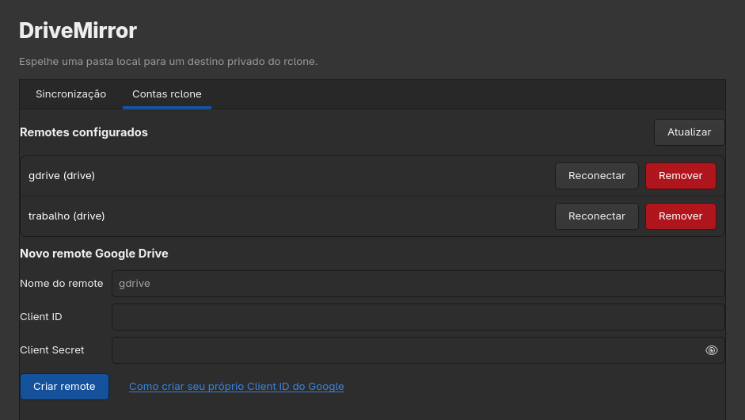

# DriveMirror

Espelha uma pasta do seu computador Linux em uma subpasta privada do Google
Drive, usando o [rclone](https://rclone.org/), com um app de bandeja simples.

[](https://github.com/israelguido/drivemirror/actions/workflows/ci.yml)
[](LICENSE)
[](releases/)
[](#requisitos)
[](https://www.rust-lang.org/)
[](https://www.gtk.org/)

## Download

[-1793d1?style=for-the-badge&logo=archlinux&logoColor=white)](https://github.com/israelguido/drivemirror/raw/main/releases/drivemirror-0.3.0-1-x86_64.pkg.tar.zst)
[-a81d33?style=for-the-badge&logo=debian&logoColor=white)](https://github.com/israelguido/drivemirror/raw/main/releases/drivemirror_0.3.0_amd64.deb)

**Omarchy / Arch Linux** (x86_64):

```bash
curl -LO https://github.com/israelguido/drivemirror/raw/main/releases/drivemirror-0.3.0-1-x86_64.pkg.tar.zst
sudo pacman -U drivemirror-0.3.0-1-x86_64.pkg.tar.zst
```

**Debian 13 / Ubuntu 24.10 ou mais novo** (amd64). O pacote depende de
`libgtk4-layer-shell0`, que só existe a partir dessas versões:

```bash
curl -LO https://github.com/israelguido/drivemirror/raw/main/releases/drivemirror_0.3.0_amd64.deb
sudo apt install ./drivemirror_0.3.0_amd64.deb
```

**Conferir o download** antes de instalar, com o arquivo
[`SHA256SUMS`](releases/SHA256SUMS) publicado junto:

```bash
curl -LO https://github.com/israelguido/drivemirror/raw/main/releases/SHA256SUMS
sha256sum -c SHA256SUMS --ignore-missing
```

A saída deve terminar em `OK` para o arquivo baixado. Se aparecer `FAILED`, não
instale.

## Para que serve

Você escolhe uma pasta local (por exemplo, suas notas do Obsidian) e uma
subpasta no Google Drive. O DriveMirror roda `rclone sync` dessa pasta para o
Drive quando você clica em **Sincronizar agora** e também automaticamente a cada
intervalo configurado. O Drive passa a ter uma cópia fiel da pasta local.

É uma cópia de mão única (computador → Drive). Alterações feitas direto no
Drive não voltam para o computador e são sobrescritas na próxima sincronização.

## Telas

| Sincronização | Contas rclone |
|---|---|
|  |  |

*Capturas feitas com dados de demonstração.*

## Recursos

- sincronização manual (janela, painel ou menu da bandeja) e automática por
  intervalo (1 minuto a 24 horas; padrão 10 minutos);
- ícone na bandeja com um painel compacto: estado, último sync, origem e
  destino, **Sincronizar agora**, **Configurações…** e **Sair**;
- aba **Contas rclone** para criar, reconectar e remover remotos do Google Drive
  sem abrir o terminal;
- filtros de arquivos e pastas a ignorar, um padrão por linha;
- interface em português (Brasil), inglês e espanhol;
- configuração em `~/.config/drivemirror/config.toml`, editável à mão;
- inicia com a sessão, direto na bandeja;
- segue o tema GTK do sistema.

O DriveMirror não cria links, compartilhamentos nem permissões públicas no Drive.

## Requisitos

- Linux x86_64 com GTK 4.
- [rclone](https://rclone.org/) instalado (os pacotes já o declaram como
  dependência).
- Um **Client ID próprio do Google** (OAuth), criado por você no Google Cloud,
  com a **Google Drive API ativada** no mesmo projeto. Veja
  [Primeiros passos](#primeiros-passos).
- `gtk4-layer-shell` (pacote `gtk4-layer-shell` no Arch, `libgtk4-layer-shell0`
  no Debian/Ubuntu), instalado automaticamente pelos pacotes.
- Para o ícone na bandeja: uma barra com suporte a StatusNotifierItem (Waybar,
  KDE Plasma etc.). No GNOME isso costuma exigir uma extensão de AppIndicator.

## Primeiros passos

1. **Crie seu Client ID do Google.** Siga o guia oficial do rclone:
   <https://rclone.org/drive/#making-your-own-client-id>. Ao final você terá um
   *Client ID* e um *Client Secret*. Guarde o secret com cuidado e não o envie
   para ninguém.
2. **Ative a Google Drive API no mesmo projeto.** No
   [Google Cloud Console](https://console.cloud.google.com/), abra
   *APIs e serviços → Biblioteca*, procure **Google Drive API** e clique em
   **Ativar**. Sem isso, a sincronização falha com
   `Google Drive API has not been used in project … or it is disabled`. Depois
   de ativar, espere alguns minutos.
3. **Abra o DriveMirror** pelo menu de aplicativos. Na primeira vez, a janela
   completa aparece.
4. **Crie a conta na aba _Contas rclone_.** Informe um nome para o remoto (por
   exemplo `gdrive`), o Client ID e o Client Secret e clique em
   **Criar remote**. O app mostra as perguntas do rclone; responda e, quando o
   navegador abrir, entre na sua conta Google e autorize. Se o navegador não
   abrir sozinho, use o link **Abrir link de autorização** que aparece no app.
   Ao terminar, a mensagem diz que o remoto está pronto.
5. **Configure a sincronização na aba _Sincronização_:**
   - **Pasta local:** clique em **Escolher…** e selecione a pasta;
   - **Remoto rclone:** só o nome, por exemplo `gdrive` (sem `:`);
   - **Pasta no Drive:** uma subpasta, por exemplo `Backup/Obsidian`. A raiz do
     Drive não é aceita;
   - **Intervalo (min)** e, se quiser, os filtros de arquivos e pastas a ignorar.
6. **Primeiro sync.** Confira origem e destino e clique em
   **Sincronizar agora**. As configurações são salvas antes de o rclone rodar.
   O resultado aparece na linha de status.

> [!WARNING]
> **O DriveMirror faz espelhamento, não backup com histórico.** Ele usa
> `rclone sync`: tudo o que você apagar na pasta local também será **apagado na
> subpasta do Drive** na próxima sincronização, e arquivos que existam só no
> destino são removidos. Escolha uma subpasta dedicada a isso. Por segurança, a
> raiz do Drive é bloqueada. Itens que batem com os filtros de exclusão não são
> apagados do Drive (o app nunca usa `--delete-excluded`).

## Painel da bandeja

Um clique no ícone da bandeja abre (ou fecha) um painel pequeno:

```
DriveMirror              ● Em dia
Último sync: 14:32
~/Notas/Obsidian → gdrive:Backup/Obsidian
[ Sincronizar agora ]
[ Configurações… ]  [ Sair ]
```

- O estado pode ser **Em dia**, **Sincronizando…**, **Falha** ou
  **Não configurado**. O horário do último sync fica só na memória e volta a
  "nunca" quando o app reinicia.
- No Hyprland, Sway e KDE Plasma (Wayland) o painel aparece no canto superior
  direito, logo abaixo da barra. Ele fecha com **Esc**, com outro clique no
  ícone ou pouco depois de o ponteiro sair dele.
- Em outros ambientes (GNOME, X11) ele abre como uma janela pequena, que fecha
  com **Esc** ou pelo botão de fechar.
- **Configurações…** abre a janela completa. O menu do ícone (clique direito)
  tem **Configurações…**, **Sincronizar agora** e **Sair**.
- **Sair** espera uma sincronização em andamento terminar antes de fechar.

Fechar a janela completa não encerra o app: ele continua na bandeja.

## Idiomas

A interface está em português (Brasil), inglês e espanhol. Por padrão segue o
idioma do sistema (`LC_ALL`, `LC_MESSAGES`, `LANG`): `pt*` usa português, `es*`
usa espanhol e os demais usam inglês. O seletor **Idioma** na aba
Sincronização troca o idioma na hora e o salva na configuração.

## Segurança

- **Credenciais ficam com o rclone.** O DriveMirror não grava o Client Secret
  nem o token em lugar nenhum; quem os guarda é o próprio rclone, em
  `~/.config/rclone/rclone.conf`. O `config.toml` do DriveMirror guarda só
  caminhos, nome do remoto, subpasta, filtros, intervalo e idioma.
- **Nada de secret em mensagens.** O campo do secret é limpo assim que o rclone
  começa, e qualquer saída do rclone mostrada no app passa por uma redação que
  troca o secret por `<redacted>`. O app não grava logs.
- **Limite conhecido:** como o rclone recebe o Client ID e o Client Secret como
  argumentos, eles ficam visíveis em `/proc` para processos do seu usuário
  enquanto o rclone roda durante a criação da conta.
- **Permissão no Drive:** o remoto é criado com o escopo `drive` do rclone
  (acesso completo ao Drive da conta autorizada), necessário para sincronizar em
  qualquer subpasta.
- **Downloads:** confira os pacotes com `SHA256SUMS` (veja [Download](#download)).
- Para reportar uma vulnerabilidade, veja [SECURITY.md](SECURITY.md).

## Solução de problemas

**"O remote "gdrive" não existe no rclone."** O nome na aba Sincronização não
corresponde a nenhum remoto do rclone. Crie a conta na aba **Contas rclone** ou
corrija o nome (sem `:`). A sincronização automática mostra o aviso uma vez e só
tenta de novo quando a configuração ou a lista de remotos muda.

**"Google Drive API has not been used in project … before or it is disabled"**.
A Google Drive API não está ativada no projeto do seu Client ID. Ative-a em
*APIs e serviços → Biblioteca → Google Drive API → Ativar* no Google Cloud
Console, espere alguns minutos e sincronize de novo.

**Remoto marcado como "incompleto"** ou a mensagem "não concluiu a
autorização". A criação da conta parou antes de o Google devolver o token (por
exemplo, o navegador foi fechado ou a operação foi cancelada). Na aba
**Contas rclone**, use **Reconectar** para autorizar de novo, ou **Remover** e
crie a conta outra vez. Remover apaga só a configuração do rclone; nenhum
arquivo do Drive é apagado.

**O painel não abre abaixo da barra (GNOME, X11 ou outro compositor).** O painel
ancorado usa o protocolo layer-shell, disponível no Hyprland, Sway e KDE Plasma
(Wayland). Nos demais ambientes ele abre como janela pequena. Se não houver
ícone na bandeja (por exemplo, GNOME sem extensão de AppIndicator), abra o
DriveMirror pelo menu de aplicativos: a janela completa funciona normalmente.

Mais casos na [wiki](https://github.com/israelguido/drivemirror/wiki/Solucao-de-problemas).

## Documentação

A [wiki do projeto](https://github.com/israelguido/drivemirror/wiki) traz guias
passo a passo de instalação, configuração do Google Drive, uso diário e
perguntas frequentes. O texto-fonte da wiki fica em [`docs/wiki/`](docs/wiki/).

## Compilar do código-fonte

Requisitos: Rust 1.88 ou mais novo (edition 2024), `pkg-config`, GTK 4 e
`gtk4-layer-shell` com os arquivos de desenvolvimento, e o rclone para usar o
app. O Rust empacotado no Debian 13 e no Ubuntu 24.10 é mais antigo que isso;
nesses sistemas instale o Rust com o [rustup](https://rustup.rs/).

```bash
# Arch / Omarchy
sudo pacman -S --needed rust pkgconf gtk4 gtk4-layer-shell rclone
# Debian 13 / Ubuntu 24.10+ (Rust via rustup)
sudo apt install build-essential pkg-config libgtk-4-dev libgtk4-layer-shell-dev rclone

git clone https://github.com/israelguido/drivemirror.git
cd drivemirror
./bin/test    # testes + clippy
./bin/build   # cargo build --release --locked
```

O binário fica em `target/release/drivemirror`. No Arch/Omarchy,
`./bin/install` gera e instala o pacote com `makepkg`. Em Debian/Ubuntu,
`./packaging/debian/build-deb` gera o `.deb`; gere-o na mesma distribuição em
que ele será instalado.

## Licença

[MIT](LICENSE).

## English

DriveMirror mirrors one local folder into a private Google Drive subfolder on
Linux, using `rclone sync` on demand and on a timer, from a small tray app (GTK
4, Rust). The UI is available in Portuguese, English and Spanish and follows
the system locale.

- **Download:** the
  [Arch package](https://github.com/israelguido/drivemirror/raw/main/releases/drivemirror-0.3.0-1-x86_64.pkg.tar.zst)
  or the
  [Debian 13 / Ubuntu 24.10+ package](https://github.com/israelguido/drivemirror/raw/main/releases/drivemirror_0.3.0_amd64.deb).
  Verify it with [`SHA256SUMS`](releases/SHA256SUMS).
- **Setup:** create your own Google OAuth Client ID
  (<https://rclone.org/drive/#making-your-own-client-id>), **enable the Google
  Drive API** in that project, then add the account in the **Rclone accounts**
  tab and pick the local folder, remote and Drive subfolder.
- **Warning:** this is a mirror, not a versioned backup. Files deleted locally
  are deleted from the Drive subfolder on the next sync. The Drive root is
  blocked.
- **Security:** the app never stores or logs the Client Secret or tokens; rclone
  keeps them in its own config. Report vulnerabilities as described in
  [SECURITY.md](SECURITY.md).
