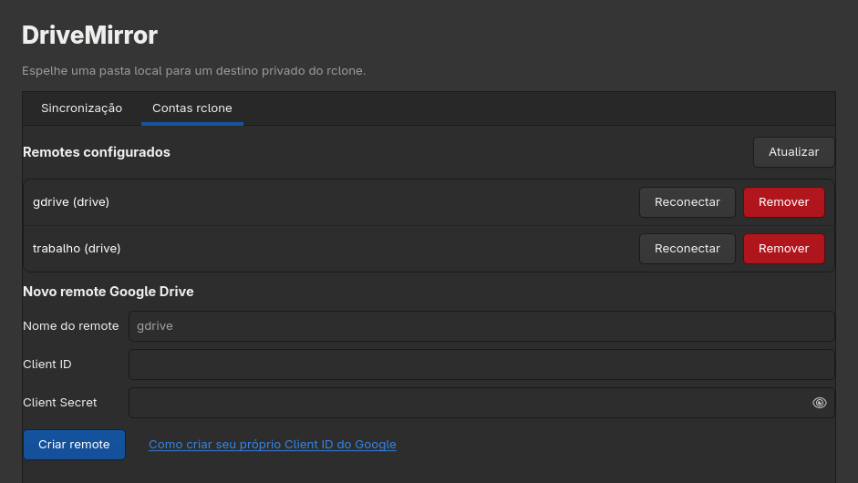

🇧🇷 [[Português|Configurar-Google-Drive]] · 🇺🇸 [[English|Set-up-Google-Drive]] · 🇪🇸 [[Español|Configuracion-de-Google-Drive]]

# Configuración de Google Drive

DriveMirror usa rclone para comunicarse con Google Drive. rclone necesita un
**Client ID propio** tuyo, porque el Client ID compartido de rclone se está
retirando. Son tres pasos: crear el Client ID, habilitar la Google Drive API y
crear la cuenta en la app.

## 1. Crear el Client ID

Sigue la guía oficial de rclone:
<https://rclone.org/drive/#making-your-own-client-id>.

En resumen, en la [Google Cloud Console](https://console.cloud.google.com/):

1. crea (o elige) un proyecto;
2. configura la pantalla de consentimiento de OAuth y agrega tu cuenta de
   Google como usuario de prueba, si la app queda en modo de prueba;
3. crea una credencial de tipo **ID de cliente de OAuth** para
   **App de escritorio** (*Desktop app*);
4. anota el **Client ID** y el **Client Secret**.

El Client Secret es una credencial. No lo pegues en chats, issues ni archivos
del repositorio.

## 2. Habilitar la Google Drive API

Este paso es fácil de olvidar y, sin él, nada funciona:

1. en el mismo proyecto, abre **APIs y servicios → Biblioteca**;
2. busca **Google Drive API**;
3. haz clic en **Habilitar**.

Si te saltas este paso, la sincronización falla con
`Google Drive API has not been used in project … before or it is disabled`.
Después de habilitarla, el cambio puede tardar unos minutos en aplicarse.

## 3. Crear la cuenta en DriveMirror

1. Abre DriveMirror y ve a la pestaña **Cuentas de rclone**.
2. En **Nuevo remoto de Google Drive**, completa:
   - **Nombre del remoto**: por ejemplo `gdrive` (letras, números, espacios
     internos y `_ . + @ -`; no puede empezar con `-`);
   - **Client ID** y **Client Secret** del paso 1.
3. Haz clic en **Crear remoto**. El campo del secret se vacía en cuanto rclone
   empieza.
4. La app muestra las preguntas de rclone, una por una. En la pregunta sobre
   usar el navegador, responde `true`.
5. El navegador se abre en la pantalla de inicio de sesión de Google. Entra con
   la cuenta que va a recibir los archivos y autoriza. Si el navegador no se
   abre, haz clic en **Abrir enlace de autorización** en la app.
6. Cuando la app muestre que el remoto está listo, aparece en la lista. Si el
   campo **Remoto de rclone** de la pestaña Sincronización está vacío, se
   completa con el nuevo nombre.

Durante la creación, solo **Cancelar** queda disponible. Si cancelas o algo
falla a mitad de camino, el remoto puede quedar **incompleto** (sin token). La
app ofrece eliminarlo y no deja sincronizar con él. Consulta
[[Solución de problemas|Solucion-de-problemas]].

## Reconectar y eliminar

- **Reconectar** pide una nueva autorización en el navegador para un remoto de
  Google Drive. Úsalo cuando el token caduque o el remoto esté incompleto.
- **Eliminar** pide confirmación y borra solo la configuración del remoto en
  rclone. **No se borra ningún archivo de Google Drive.**

Los remotos de otros tipos creados fuera de la app (S3, etc.) aparecen en la
lista y se pueden eliminar, pero DriveMirror solo crea y reconecta remotos de
Google Drive.

## Próximo paso

Configura la carpeta y haz la primera sincronización:
[[Uso cotidiano|Uso-cotidiano]].
