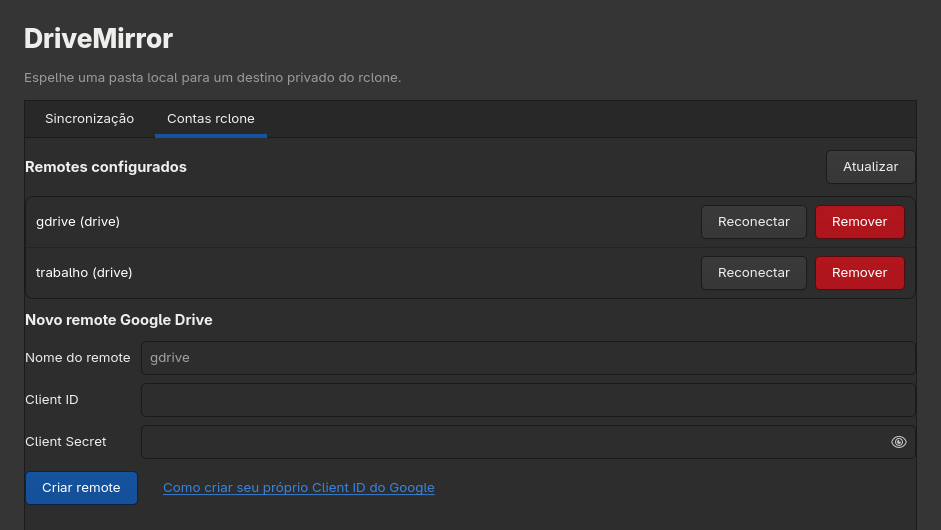

🇧🇷 [[Português|Configurar-Google-Drive]] · 🇺🇸 [[English|Set-up-Google-Drive]] · 🇪🇸 [[Español|Configuracion-de-Google-Drive]]

# Configurar o Google Drive

O DriveMirror usa o rclone para falar com o Google Drive. O rclone precisa de um
**Client ID próprio** seu, porque o Client ID compartilhado do rclone está sendo
desativado. São três etapas: criar o Client ID, ativar a Google Drive API e
criar a conta no app.

## 1. Criar o Client ID

Siga o guia oficial do rclone:
<https://rclone.org/drive/#making-your-own-client-id>.

Em resumo, no [Google Cloud Console](https://console.cloud.google.com/):

1. crie (ou escolha) um projeto;
2. configure a tela de consentimento OAuth e adicione a sua conta Google como
   usuário de teste, se o app ficar em modo de teste;
3. crie uma credencial do tipo **ID do cliente OAuth** para **App para
   computador** (*Desktop app*);
4. anote o **Client ID** e o **Client Secret**.

O Client Secret é uma credencial. Não o cole em chats, issues ou arquivos do
repositório.

## 2. Ativar a Google Drive API

Este passo é fácil de esquecer e, sem ele, nada funciona:

1. no mesmo projeto, abra **APIs e serviços → Biblioteca**;
2. procure **Google Drive API**;
3. clique em **Ativar**.

Se você pular este passo, a sincronização falha com
`Google Drive API has not been used in project … before or it is disabled`.
Depois de ativar, a mudança pode levar alguns minutos para valer.

## 3. Criar a conta no DriveMirror

1. Abra o DriveMirror e vá para a aba **Contas rclone**.
2. Em **Novo remote Google Drive**, preencha:
   - **Nome do remote**: por exemplo `gdrive` (letras, números, espaços internos
     e `_ . + @ -`; não pode começar com `-`);
   - **Client ID** e **Client Secret** do passo 1.
3. Clique em **Criar remote**. O campo do secret é limpo assim que o rclone
   começa.
4. O app mostra as perguntas do rclone, uma por vez. Para a pergunta sobre usar
   o navegador, responda `true`.
5. O navegador abre na tela de login do Google. Entre com a conta que vai
   receber os arquivos e autorize. Se o navegador não abrir, clique em
   **Abrir link de autorização** no app.
6. Quando o app mostrar que o remoto está pronto, ele aparece na lista. Se o
   campo **Remoto rclone** da aba Sincronização estiver vazio, ele é preenchido
   com o novo nome.

Durante a criação, só o **Cancelar** fica disponível. Se você cancelar ou algo
falhar no meio, o remoto pode ficar **incompleto** (sem token). O app oferece
removê-lo e não deixa sincronizar com ele. Veja
[[Solução de problemas|Solucao-de-problemas]].

## Reconectar e remover

- **Reconectar** pede uma nova autorização no navegador para um remoto do
  Google Drive. Use quando o token expirar ou o remoto estiver incompleto.
- **Remover** pede confirmação e apaga só a configuração do remoto no rclone.
  **Nenhum arquivo do Google Drive é apagado.**

Remotos de outros tipos criados fora do app (S3 etc.) aparecem na lista e podem
ser removidos, mas só remotos do Google Drive são criados e reconectados pelo
DriveMirror.

## Próximo passo

Configure a pasta e faça o primeiro sync: [[Uso diário|Uso-diario]].
