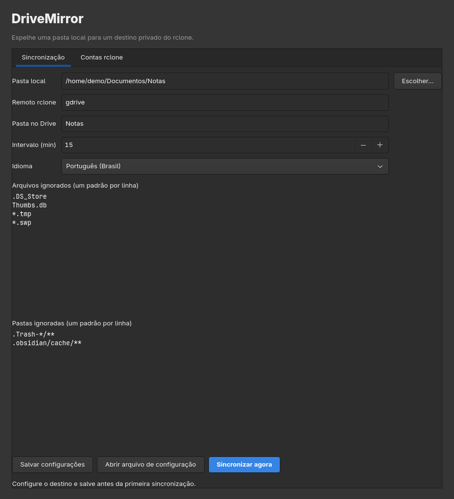

🇧🇷 [[Português|Home]] · 🇺🇸 [[English|Home-EN]] · 🇪🇸 [[Español|Inicio]]

# DriveMirror

DriveMirror es una pequeña app para Linux que mantiene una **copia reflejada de
una carpeta de tu equipo** en una subcarpeta privada de **Google Drive**. Usa
[rclone](https://rclone.org/) por debajo y se queda en la bandeja del sistema,
sincronizando cuando lo pides y en cada intervalo configurado.

*Capturas hechas con datos de demostración.*

## Para quién es

- Quien usa Linux (Omarchy, Arch, Debian 13, Ubuntu 24.10+) y quiere una
  carpeta siempre copiada a Drive, sin cliente oficial de Google.
- Quien prefiere una interfaz sencilla a armar comandos y temporizadores de
  rclone a mano.
- Quien entiende que es un **espejo de un solo sentido**: Drive pasa a reflejar
  la carpeta local, incluidas las exclusiones.

No es una copia de seguridad con historial de versiones ni una sincronización
bidireccional. Los archivos borrados en el equipo se borran en Drive en la
siguiente sincronización. Consulta
[[Preguntas frecuentes|Preguntas-frecuentes]].

## Por dónde empezar

1. [[Instalación|Instalacion]]: descargar e instalar el paquete.
2. [[Configuración de Google Drive|Configuracion-de-Google-Drive]]: Client ID,
   Google Drive API y creación de la cuenta en la app.
3. [[Uso cotidiano|Uso-cotidiano]]: panel de la bandeja, sincronización,
   intervalo y exclusiones.
4. [[Solución de problemas|Solucion-de-problemas]]: mensajes de error comunes y
   qué hacer.

## Enlaces

- Repositorio y README: <https://github.com/israelguido/drivemirror>
- Paquetes: <https://github.com/israelguido/drivemirror/tree/main/releases>
- Seguridad y cómo reportar vulnerabilidades:
  <https://github.com/israelguido/drivemirror/blob/main/SECURITY.md>
- Licencia: MIT
