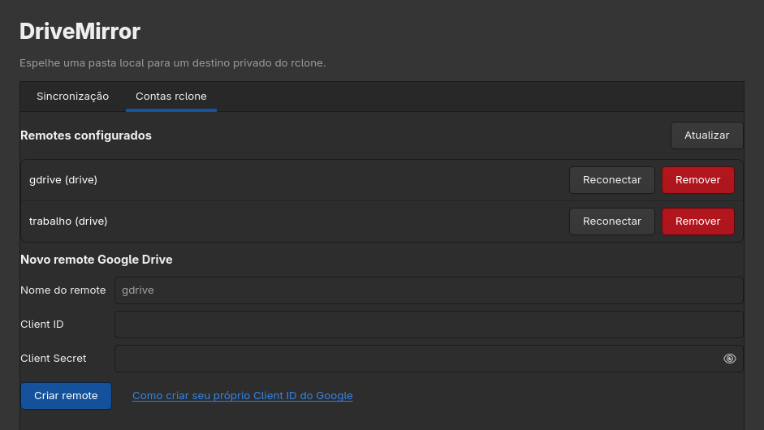

🇧🇷 [[Português|Configurar-Google-Drive]] · 🇺🇸 [[English|Set-up-Google-Drive]] · 🇪🇸 [[Español|Configuracion-de-Google-Drive]]

# Set up Google Drive

DriveMirror uses rclone to talk to Google Drive. rclone needs a **Client ID of
your own**, because rclone's shared Client ID is being retired. There are three
steps: create the Client ID, enable the Google Drive API and create the account
in the app.

## 1. Create the Client ID

Follow the official rclone guide:
<https://rclone.org/drive/#making-your-own-client-id>.

In short, in the [Google Cloud Console](https://console.cloud.google.com/):

1. create (or pick) a project;
2. set up the OAuth consent screen and add your Google account as a test user,
   if the app stays in testing mode;
3. create a credential of type **OAuth client ID** for a **Desktop app**;
4. write down the **Client ID** and the **Client Secret**.

The Client Secret is a credential. Do not paste it into chats, issues or
repository files.

## 2. Enable the Google Drive API

This step is easy to forget, and without it nothing works:

1. in the same project, open **APIs & Services → Library**;
2. search for **Google Drive API**;
3. click **Enable**.

If you skip this step, syncing fails with
`Google Drive API has not been used in project … before or it is disabled`.
After enabling it, the change can take a few minutes to apply.

## 3. Create the account in DriveMirror

1. Open DriveMirror and go to the **Rclone accounts** tab.
2. Under **New Google Drive remote**, fill in:
   - **Remote name**: for example `gdrive` (letters, digits, inner spaces and
     `_ . + @ -`; it cannot start with `-`);
   - **Client ID** and **Client Secret** from step 1.
3. Click **Create remote**. The secret field is cleared as soon as rclone
   starts.
4. The app shows rclone's questions, one at a time. For the question about
   using the browser, answer `true`.
5. The browser opens on the Google sign-in page. Sign in with the account that
   will receive the files and authorize. If the browser does not open, click
   **Open authorization link** in the app.
6. When the app shows that the remote is ready, it appears in the list. If the
   **Rclone remote** field of the Sync tab is empty, it is filled in with the
   new name.

During creation, only **Cancel** is available. If you cancel or something fails
midway, the remote may be left **incomplete** (without a token). The app offers
to remove it and does not let you sync with it. See
[[Troubleshooting|Troubleshooting]].

## Reconnect and remove

- **Reconnect** asks for a new authorization in the browser for a Google Drive
  remote. Use it when the token expires or the remote is incomplete.
- **Remove** asks for confirmation and deletes only the remote's configuration
  in rclone. **No files on Google Drive are deleted.**

Remotes of other types created outside the app (S3 etc.) appear in the list and
can be removed, but only Google Drive remotes are created and reconnected by
DriveMirror.

## Next step

Set up the folder and run the first sync: [[Daily use|Daily-use]].
